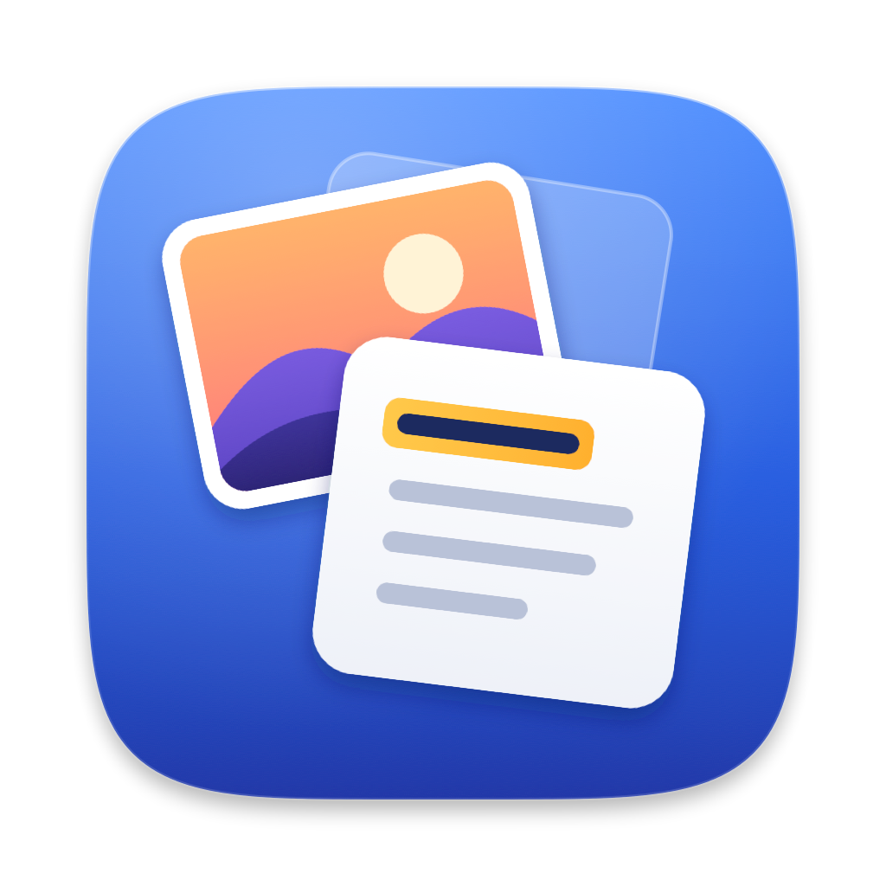

# Clipboard Remix app icon: design proposal

Status: **approved and installed.** `Resources/AppIcon.icns` is copied into the app bundle by `scripts/build.sh` before signing.



## Files

| File | Purpose |
|---|---|
| `clipboard-remix-icon.svg` | Editable vector master (1024 × 1024, transparent). Plain SVG that opens in Figma, Sketch, Illustrator, or a browser. |
| `make_icon_svg.py` | Regenerates the SVG. The script keeps the squircle outline exact, so edit colours and shapes there or in the SVG. |
| `clipboard-remix-icon-1024.png` | 1024 px master PNG with alpha. |
| `png/icon_{16,32,64,128,256,512}.png` | Each size is rendered from the vector, not downscaled from the 1024 PNG. |
| `small-size-preview.png` | Sizes from 16 to 256 px on light and dark backgrounds, with magnified views of 16 px and 32 px. |
| `render_svg.swift` | Local WebKit SVG→PNG renderer used to make the PNGs. Needs no Xcode or third-party tools. |

## Concept: a stack of saved clips

- **Front card: a text clip.** A white sheet with grey lines. The top line has a yellow highlight, a nod to both a search match and the selected row in the two-pane palette.
- **Behind it: a screenshot clip.** A framed photo with a warm sky, a sun, and violet hills. This shows that the app saves images as well as text. It was the main gap in the generic "clipboard" glyph.
- **Ghost card at the back: older history.** A translucent card suggests depth, meaning more clips further down the list. It also balances the composition.
- **Body.** A macOS squircle (superellipse, 824 px body on the 1024 grid) with a blue gradient based on the palette accent `#0A64D6` from the design sketches. It also has a soft top light and a thin rim highlight.
- **No clipboard board, clip, or mascot.** This keeps clear of Pastebot's clipboard-and-robot look and of the SF Symbol `clipboard` used in the menu bar. The menu-bar glyph should stay a template SF Symbol.

## Small sizes

At 16–32 px the icon reads as a blue tile with a warm photo and a white card. The text lines blur into texture at 16 px, which is normal for app icons, and the silhouette still stands apart from other blue system icons because of the orange. A follow-up could add a simplified 16/32 px variant without the ghost card and with two text lines.

## Rendering / regenerating

```sh
python3 make_icon_svg.py
B=/Volumes/Expansion/pastebot-remix-build/icon-design
swiftc -O -module-cache-path $B/modcache render_svg.swift -o $B/render
$B/render clipboard-remix-icon.svg clipboard-remix-icon-1024.png 1024
```

The production `.icns` built with `iconutil` from these PNGs is checked in at `Resources/AppIcon.icns`. Builds use that file without requiring the design tools.

## Limitations

- This is a flat Big Sur-style icon, not an Icon Composer / Liquid Glass layered `.icon` file for macOS 26. Making one needs Xcode's Icon Composer, which is not installed. The SVG groups (body, ghost card, photo card, text card) map directly onto Icon Composer layers.
- The squircle is a superellipse approximation of Apple's continuous-corner shape, not Apple's template path.
